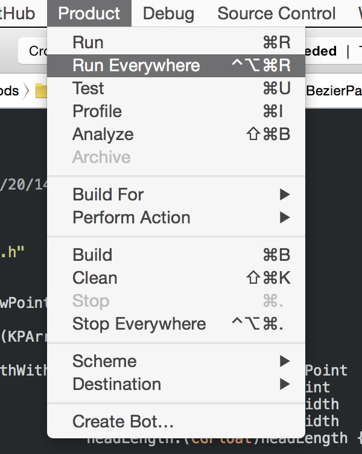

<!-- title -->

# KPRunEverywhereXcodePlugin

<!-- /title -->

<!-- badges -->

[](https://opensource.org/license/mit)

<!-- /badges -->

<!-- short-description -->

**An Xcode 7 plugin to build and run an app across multiple iOS devices with one click.**

<!-- /short-description -->

> [!IMPORTANT]
>
> This was nice while it lasted, but Xcode has long since abandoned support for this type of plugin.

## Overview

Gone are the days of manually switching between device destinations and fiddling with the "play" and "stop" buttons. RunEverywhere streamlines development and testing across multiple iPhone / iPod models. This is especially handy if you're building multi-player games, universal apps, or networked apps in general.

The plugin adds two new commands to [Xcode's](https://developer.apple.com/xcode/) "Product" menu.



## Getting started

### Dependencies

KPRunEverywhere is compatible with Xcode 5, 6, and 7. It doesn't work with Xcode 8 or newer, which dropped support for plugins. (See [Known issues](#known-issues).)

It's specifically tested and known to work on:

- Xcode 5.1.0 + OS X 10.9.2
- Xcode 6.0.1 + OS X 10.9.5
- Xcode 6.3.0 + OS X 10.10.3
- Xcode 7.0.1 + OS X 10.11.0
- Xcode 7.1.0 + OS X 10.11.1

Later updates added the plugin compatibility UUIDs for Xcode 7.2 and 7.3, and a fix for a crash in Xcode 7.2.1. The Xcode project was last updated with Xcode 7, and targets OS X 10.10 or newer.

### Installation

Two options here:

#### Via Alcatraz

RunEverywhere is available through the [Alcatraz](https://github.com/alcatraz/Alcatraz) Xcode plugin management system.

#### From source

Clone the repository and open the project in Xcode:

```sh
git clone https://github.com/kitschpatrol/KPRunEverywhereXcodePlugin.git
open KPRunEverywhereXcodePlugin/KPRunEverywhereXcodePlugin.xcodeproj
```

Simply build the Xcode project and restart Xcode. The plugin will automatically install to `~/Library/Application Support/Developer/Shared/Xcode/Plug-ins/`.

To uninstall, just remove the plugin from the above directory, and restart Xcode:

```sh
rm -rf ~/Library/Application\ Support/Developer/Shared/Xcode/Plug-ins/KPRunEverywhereXcodePlugin.xcplugin
```

## Usage

Connect your iOS devices, then choose a command from the "Product" menu or use its keyboard shortcut:

| Command             | Shortcut                                                  | Description                                      |
| ------------------- | --------------------------------------------------------- | ------------------------------------------------ |
| **Run Everywhere**  | <kbd>⌃</kbd> + <kbd>⌥</kbd> + <kbd>⌘</kbd> + <kbd>R</kbd> | Builds and runs the app on all attached devices. |
| **Stop Everywhere** | <kbd>⌃</kbd> + <kbd>⌥</kbd> + <kbd>⌘</kbd> + <kbd>.</kbd> | Stops the app on all attached devices.           |

## Background

### Implementation notes

The plugin works by driving Xcode's own menus. Run Everywhere reads the device list from the "Product > Destination" menu, then selects each device in turn and triggers "Build" and "Run" from the "Product" menu. It waits for Xcode's internal build and launch notifications before moving on to the next device, instead of waiting for a fixed amount of time, and reselects the original destination at the end. Stop Everywhere triggers "Stop" until the menu item is no longer enabled.

Xcode builds the destination list lazily when the menu is opened, so the plugin asks the menu's delegate to populate it before reading it.

### Known issues

- This isn't going to work on the simulator.
- Running everywhere might not work if Xcode loses focus during the app-launch process. I recommend giving Xcode a second to collect itself after invoking Run Everywhere. This is an unfortunate side-effect of the menu-manipulating implementation.
- Unfortunately, Apple removed support for traditional plugins in Xcode 8, and the new official APIs do not allow the functionality implemented in KPRunEverywhere. [Issue #17](https://github.com/kitschpatrol/KPRunEverywhereXcodePlugin/issues/17) has the details. An AppleScript approach might be your best bet if you need this functionality in Xcode 8+.

## Maintainers

[kitschpatrol](https://github.com/kitschpatrol)

## Acknowledgments

Built with [Delisa Mason's](https://github.com/kattrali) excellent [Xcode Plugin Template](https://github.com/kattrali/Xcode-Plugin-Template).

Inspiration was drawn from a couple of Stack Overflow threads:

- [How to 'Build & Run' on multiple destinations at once in Xcode?](https://stackoverflow.com/questions/16262553/how-to-build-run-on-multiple-destinations-at-once-in-xcode)
- [Xcode 4 - One Click Build to Multiple Devices?](https://stackoverflow.com/questions/8040940/xcode-4-one-click-build-to-multiple-devices)
- [Run on simulator and phone with one click](https://stackoverflow.com/questions/15300241/run-on-simulator-and-phone-with-one-click)
- [Is it possible to run an app on two devices with one click on the build and run button in Xcode 5?](https://stackoverflow.com/questions/22116564/is-it-possible-to-run-an-app-on-two-devices-with-one-click-on-the-build-and-run)

Thanks to [Simon Fridlund](https://github.com/zimme) for adding the Xcode 7.2 compatibility UUID, and to [Simon Coulton](https://github.com/simoncoulton) for fixing a crash in Xcode 7.2.1.

<!-- license -->

## License

[MIT](license.txt) © [Eric Mika](https://ericmika.com)

<!-- /license -->
